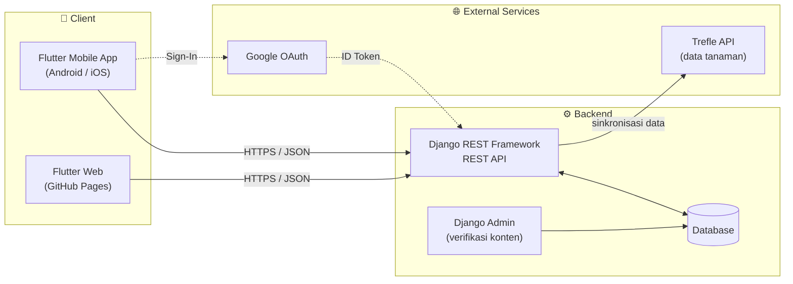
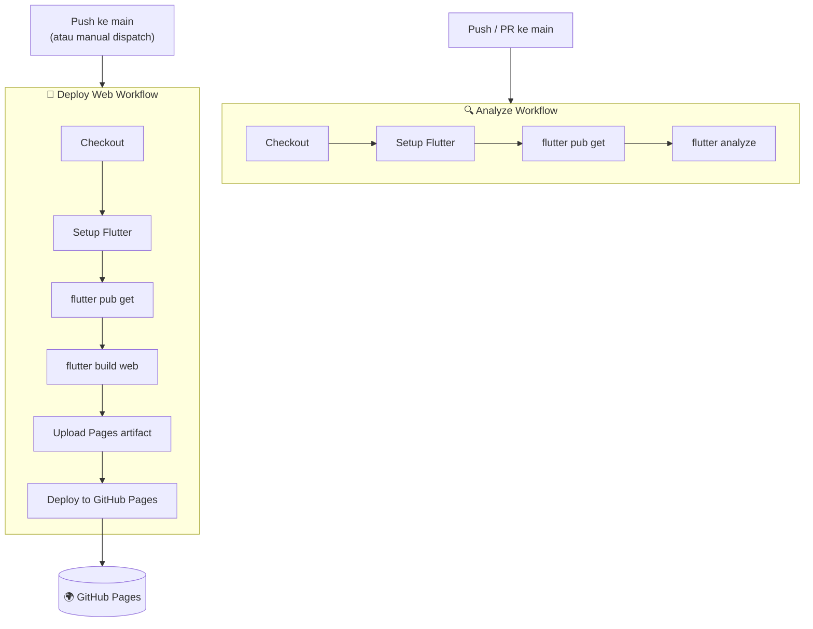

<h1 align="center">Tanampedia Mobile</h1>
<h6 align="center">Tumbuh Bersama, Di Mana Saja</h6>

<div align="center">

<p>
  
  
  
</p>

</div>

<p align="center">
    <strong>Kelas</strong> PBP F | <strong>Kelompok</strong> 11 <br/>
    <strong>We 💓 Mobile Development</strong>
</p>

**Tanampedia Mobile** adalah aplikasi edukasi dan berbagi pengetahuan berbasis komunitas yang menghubungkan petani dan pekebun satu sama lain. Aplikasi ini dirancang untuk petani muda yang lebih menikmati proses belajar yang interaktif dan gamified dibandingkan metode konvensional. Tanampedia Mobile menghadirkan ruang diskusi, katalog tanaman yang terverifikasi, kuis dan challenge harian, serta fitur AR untuk melihat tanaman dalam wujud model 3D melalui kamera ponsel. Melalui aplikasi ini, siapa pun dapat memulai berkebun skala kecil dan berkontribusi pada gaya hidup yang lebih berkelanjutan, kapan saja dan di mana saja.

### Anggota

|                                                                                                   | NPM        | Nama                               | Jurusan                                         | Role                                              |
| :-----------------------------------------------------------------------------------------------: | ---------- | ---------------------------------- | ----------------------------------------------- | ------------------------------------------------- |
|          | 2506551125 | **Ervhino Aryo Seto**              | Information Systems '25 @ Universitas Indonesia | Katalog Tanaman                                   |
|                           | 2506596041 | **Forza Derian**                   | Information Systems '25 @ Universitas Indonesia | Kuis & Challenge Harian                           |
|             | 2506584861 | **Mohammad Zidane Kurnianto**      | Information Systems '25 @ Universitas Indonesia | Authentication, Profile, Leaderboard, & ARboretum |
|  | 2506588752 | **Muhammad Fairus Azfar Arisandi** | Information Systems '25 @ Universitas Indonesia | User Journal & Posting                            |
|            | 2506602896 | **Muhammad Naufal Syarifuddin**    | Information Systems '25 @ Universitas Indonesia | Q&A Forum                                         |

## Module Definition

| Module                  | Penanggung Jawab               |
| ----------------------- | ------------------------------ |
| Authentication          | Mohammad Zidane Kurnianto      |
| Q&A Forum               | Muhammad Naufal Syarifuddin    |
| Katalog Tanaman         | Ervhino Aryo Seto              |
| Kuis & Challenge Harian | Forza Derian                   |
| User Journal & Posting  | Muhammad Fairus Azfar Arisandi |
| ARboretum               | Mohammad Zidane Kurnianto      |

### Authentication

Mengelola seluruh siklus akun pengguna, yaitu register, login, dan logout. Modul ini mendukung **Google OAuth** untuk kemudahan login, dengan fallback register dan login manual (email dan kata sandi) bagi pengguna yang tidak menggunakan akun Google. Modul ini juga menyediakan halaman profil yang menampilkan progres pengguna secara keseluruhan, yaitu pengalaman (XP) dan **PediaPoint**. PediaPoint merupakan poin yang terkumpul dari keaktifan pengguna di seluruh modul lain, seperti upvote jawaban forum, like pada journal, dan jawaban kuis yang benar, sehingga menjadi representasi kontribusi pengguna di Tanampedia.

### Q&A Forum

Ruang diskusi tempat pengguna dapat mengunggah pertanyaan seputar bertani dan menjawab pertanyaan pengguna lain. Setiap jawaban dapat di-upvote oleh pengguna yang merasa terbantu. Upvote yang diterima akan memberikan **PediaPoint** kepada penjawab, sehingga mendorong pemberian jawaban yang berkualitas dan dapat dipercaya.

### Katalog Tanaman

Database referensi tanaman yang datanya diambil dari **Trefle API**. Modul ini berisi detail cara menanam dan merawat tiap tanaman, mulai dari kebutuhan cahaya, air, suhu, hingga jenis tanah yang sesuai. Dilengkapi dengan fitur pencarian dan pengurutan, modul ini menjadi rujukan utama sebelum pengguna memutuskan untuk menanam sesuatu, sekaligus menjadi pintu masuk ke fitur **ARboretum**.

### Kuis & Challenge Harian

Modul kuis singkat berformat _multiple choice_ seputar dasar-dasar bertani, dengan soal yang diperbarui sekali sehari. Setiap jawaban benar memberikan **PediaPoint**, sehingga mendorong pengguna untuk kembali ke aplikasi setiap hari sambil belajar dengan cara yang lebih interaktif dibandingkan metode belajar konvensional.

### User Journal & Posting

Fitur sosial tempat pengguna dapat mengunggah foto beserta caption ke publik, misalnya progres kebun, hasil panen, atau momen bertani lainnya. Unggahan ini dapat dilihat dan disukai oleh pengguna lain. Setiap like yang diterima memberikan **PediaPoint** kepada pemilik unggahan, sehingga journal menjadi ruang berbagi sekaligus sumber motivasi antarpengguna.

### ARboretum

Fitur augmented reality (AR) yang memungkinkan pengguna melihat tanaman dalam bentuk model 3D secara langsung di ruang nyata, sebelum memutuskan untuk menanamnya. Fitur ini dapat diakses dari halaman detail tanaman pada Katalog. Pengguna dapat memutar dan memperbesar model 3D tersebut, kemudian menekan tombol AR untuk menampilkan tanaman tersebut di balkon, meja, atau sudut ruangan melalui kamera ponsel, dengan skala yang menyerupai ukuran aslinya.

## Setup

### Prerequisites

- [Flutter SDK](https://docs.flutter.dev/get-started/install)
- Device, emulator, atau simulator yang sudah terhubung

### Installation

```bash
git clone <repo-url>
cd tanampedia-mobile
flutter pub get
```

### Running

```bash
flutter run
```

### Analyze & Test

```bash
flutter analyze
flutter test
```

## Folder Structure

Proyek ini mengikuti arsitektur **feature-based dan sedikit terinspirasi dari _clean architecture_**.

```
lib/
├── core/                 # Kode bersama yang dipakai lintas fitur (utils, constants, services, dll.)
└── features/
    ├── [feature]/
    │   ├── data/         # Data management, models, & fetching
    │   ├── pages/        # Susunan dan tampilan satu halaman
    │   └── widgets/      # Komponen reusable
    └── example/          # Template skeleton untuk fitur baru (data/pages/widgets)
```

## System Architecture

Tanampedia menggunakan satu backend untuk melayani banyak client. Flutter Mobile (Android/iOS) dan Flutter Web berjalan di atas API yang sama, yang disajikan oleh layanan **Django REST Framework**. Backend ini menjadi satu-satunya sumber data, meliputi data pengguna, forum, journal, hingga PediaPoint. Backend ini juga menjadi penghubung ke layanan pihak ketiga, yaitu **Trefle API** untuk data katalog tanaman dan **Google OAuth** untuk proses login.



## CI/CD Pipeline

Setiap perubahan pada branch `main` otomatis melewati dua pipeline independen di GitHub Actions. Pipeline pertama, **Analyze**, menjaga kualitas kode. Pipeline kedua, **Deploy Web**, membangun dan menerbitkan versi web aplikasi ini ke **GitHub Pages**.


